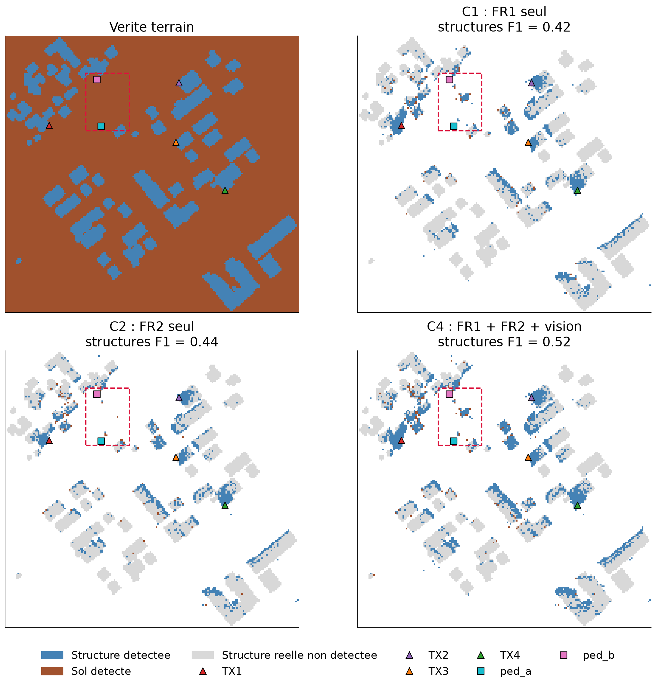
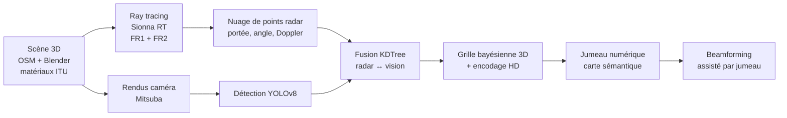
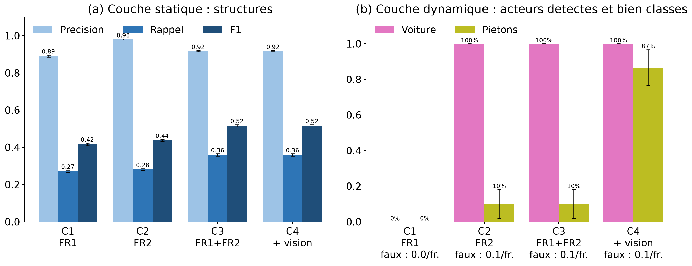
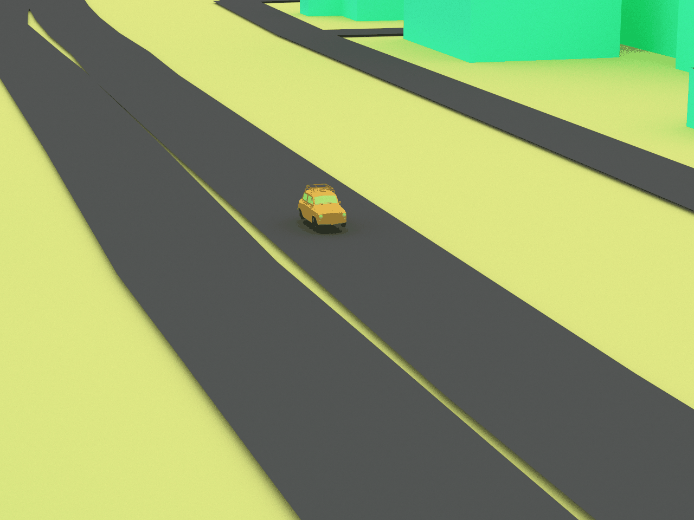
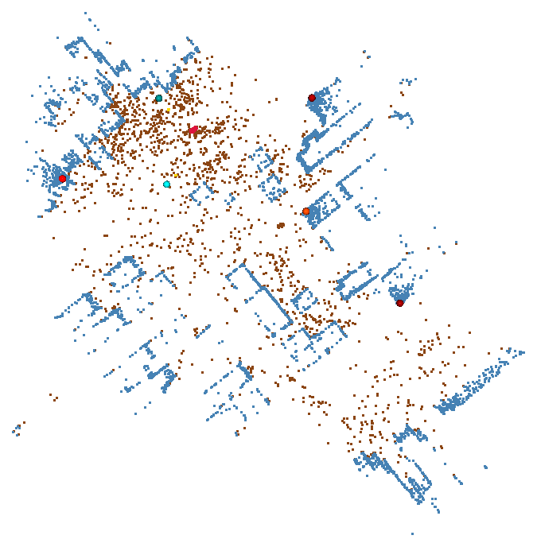

# SDM-VA-ISAC — Cartographie numérique sémantique par ISAC assisté par la vision

Projet de fin d'études (INPT, Rabat) : un **jumeau numérique 6G** qui fusionne les mesures radar
des stations de base (ISAC, *Integrated Sensing and Communication*) et la vision par caméra pour
construire une **carte sémantique 3D dynamique** d'un quartier urbain, puis l'exploite pour le
**beamforming en bande millimétrique**.



## En bref

- **Simulation radio** par ray tracing GPU (Sionna RT / Mitsuba 3) sur une scène construite depuis
  OpenStreetMap et Blender, avec matériaux électromagnétiques ITU.
- **Sensing double bande** : FR1 3,5 GHz (100 MHz) et FR2 28 GHz (400 MHz), radar monostatique sur
  4 à 5 stations de base, bilan de liaison complet (gain d'antenne, gain de traitement, bruit,
  seuil de SNR 13 dB) et séparation des cibles mobiles par Doppler.
- **Vision** : YOLOv8 entraîné sur des rendus annotés automatiquement par projection de la vérité
  terrain 3D (mAP50 = 0,965 puis 0,978).
- **Fusion** radar ↔ vision par KDTree et **grille d'occupation bayésienne 3D** avec encodage
  hyper-dimensionnel.
- **Évaluation** contre la vérité terrain, sur 10 tirages de bruit.
- **En cours** : sélection de faisceaux assistée par le jumeau (UPA 16×16, codebook DFT de 256
  faisceaux à 28 GHz).

## Chaîne de traitement



## Résultats principaux (phase 5)

Comparaison de quatre configurations de jumeau sur une séquence dynamique (voiture et deux piétons
en mouvement), par rapport à la vérité terrain :

| Configuration | Erreur médiane des points | Précision structures | F1 structures | Points fantômes | Piétons bien classés |
|---|---|---|---|---|---|
| C1 — radar FR1 seul | 0,77 m | 89 % | 0,42 | 27 % | 0 % |
| C2 — radar FR2 seul | **0,44 m** | **98 %** | 0,44 | **12 %** | 0 à 20 % |
| C3 — FR1 + FR2 | 0,57 m | 92 % | **0,52** | 20 % | 0 à 20 % |
| C4 — FR1 + FR2 + vision | 0,57 m | 92 % | **0,52** | 20 % | **77 à 97 %** |

- Sur les mesures radar brutes, l'erreur médiane passe de **2,0 m (FR1) à 0,42 m (FR2)**, grâce à
  la résolution en distance de 0,37 m à 400 MHz.
- La double bande améliore la couverture des structures (F1 de 0,44 à 0,52).
- La vision est ce qui rend les piétons identifiables, avec une erreur de position inférieure à 0,4 m.



## Déroulé du projet

| Phase | Contenu | Dossier |
|---|---|---|
| 2 | Scène Sionna RT calibrée, réponses impulsionnelles, PDP, carte de couverture | racine, `scene/`, `hj_report/` |
| 3 | Perception multimodale : radar Sionna, YOLOv8 fine-tuné, fusion KDTree, 4 stations de base + 2 capteurs | `phase3/` |
| 4 | Grille sémantique bayésienne 3D, encodage hyper-dimensionnel, visualisation Open3D | `phase4/` |
| 5 | Jumeau numérique double bande FR1 + FR2, évaluation quantitative C1 à C4 | `phase5/` |
| 6 (en cours) | Beamforming assisté par jumeau numérique en FR2 | `Digital Twin assisted beamforming design/` |

<p align="center">
  
  
</p>

## Beamforming assisté par jumeau numérique (en cours)

À 28 GHz, une station de base avec un réseau UPA 16×16 doit normalement balayer ses 256 faisceaux
DFT pour trouver le meilleur. L'idée est d'utiliser le jumeau comme **simulateur de canal propre au
site** : il classe les faisceaux à l'avance, et la station de base ne mesure plus que les *K*
meilleurs (*K* ≪ 256).

**Étapes réalisées**
1. **Séquence dynamique** de 100 trames (10 s) : 7 utilisateurs mobiles (2 voitures, 5 piétons),
   un bus qui crée des blocages, du mobilier urbain et des matériaux volontairement perturbés pour
   séparer le « monde réel » du jumeau. Avec YOLO v3 (mAP50 = 0,978), les piétons sont
   correctement classés dans 81 à 100 % des trames, contre 0 à 63 % avec le radar seul.
2. **Canal « réel » FR2** par ray tracing (réflexions, diffusion, diffraction) sur 5 stations de
   base : meilleur faisceau et meilleure station par trame, SNR médian de 37 à 43 dB selon
   l'utilisateur, 215 liens bloqués par des acteurs mobiles.

**Étapes suivantes** : comparer plusieurs niveaux de fidélité du jumeau (localisation seule,
bâtiments seuls, objets perçus, scène exacte) au balayage exhaustif et à la recherche hiérarchique
5G NR, avec comme métriques la précision top-*K*, la perte de SNR, le surcoût d'entraînement et le
débit effectif.


Le détail de l'architecture est dans
[`proposition_architecture_DT_beamforming.pdf`](Digital%20Twin%20assisted%20beamforming%20design/proposition_architecture_DT_beamforming.pdf),
et l'ordre d'exécution des scripts dans
[`code/README.md`](Digital%20Twin%20assisted%20beamforming%20design/code/README.md).

## Structure du dépôt

```
sionna_rt_osm_pipeline.ipynb        Phase 2 : pipeline Sionna RT sur la scène OSM
scene/, riad.xml, meshes/, osm/     Scènes Mitsuba et données OpenStreetMap
hj_report/                          Rapport de la phase 2 (LaTeX + PDF)
phase3/                             Perception multimodale (notebook v3, scripts YOLO, scène new.xml)
phase4/                             Carte sémantique 3D
phase5/                             Jumeau numérique double bande et évaluation
Digital Twin assisted beamforming design/
    code/                           Scripts des étapes 1 et 2 (voir son README)
    Scene_reelle/                   Scène « réelle » animée (Blender + Mitsuba)
    etape1/, etape2/                Résultats (JSON, figures)
    yolo_v3/                        Métriques d'entraînement du détecteur
rapport_SDM-VA-ISAC_phases2-5.pdf   Rapport global (LaTeX + PDF)
RECAP_PROJET.md                     Journal technique détaillé (problèmes rencontrés et correctifs)
install_env.ps1                     Installation de l'environnement
```

## Environnement

- Windows, Python 3.11, GPU NVIDIA avec CUDA (développé sur une RTX 4070)
- Sionna 2.0.1 / Sionna RT, Mitsuba 3.8.0, DrJIT 1.3.1, PyTorch CUDA
- Ultralytics YOLOv8, SciPy, Open3D, Plotly, Blender 3.6 (export de scène)

```powershell
.\install_env.ps1                                     # installe l'environnement dans .venv
.venv\Scripts\jupyter notebook sionna_rt_osm_pipeline.ipynb
```

Les notebooks contiennent des chemins absolus vers le dossier de travail d'origine : il faut les
adapter avant de les relancer sur une autre machine.

**Données non versionnées**, car trop lourdes ou régénérables par les scripts : rendus caméra,
caches radar, jeux de données YOLO, poids des modèles (`*.pt`) et matrices de canal `H_fr2.npy`
(110 Mo).

## Rapport

Le rapport complet des phases 2 à 5 est disponible ici :
[`rapport_SDM-VA-ISAC_phases2-5.pdf`](rapport_SDM-VA-ISAC_phases2-5.pdf).
